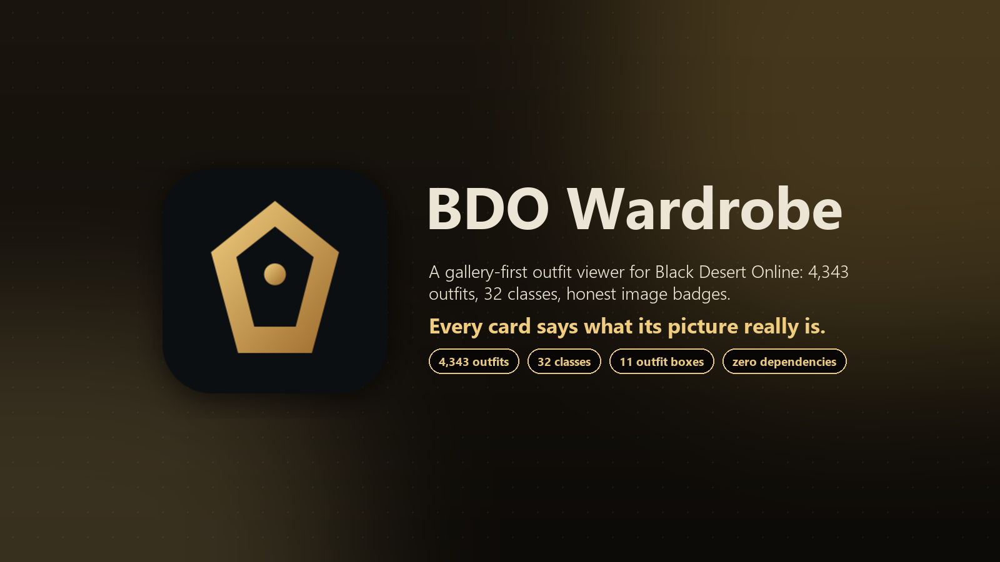
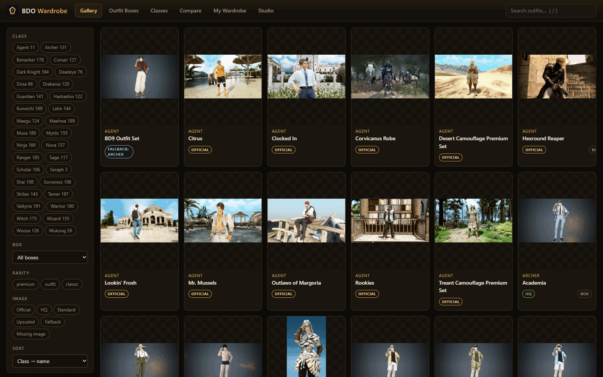
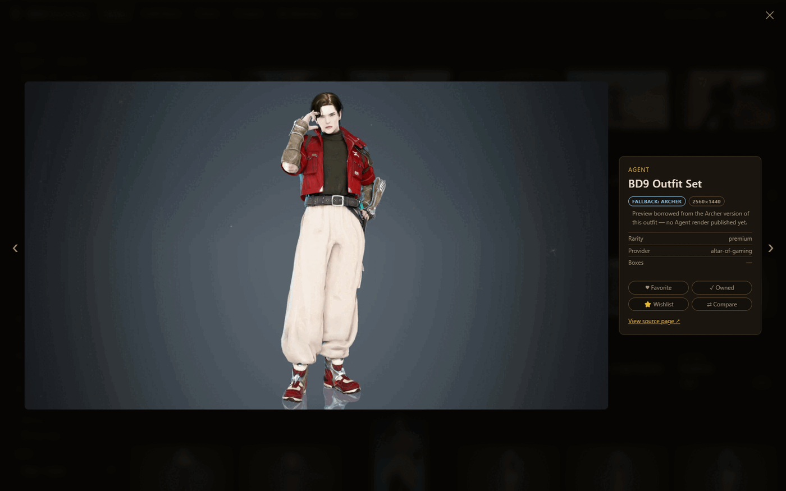
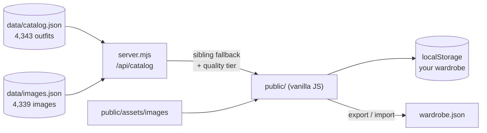

<div align="center">



[](https://github.com/SenjuWoo/bdo-wardrobe/actions/workflows/ci.yml)
[](https://github.com/SenjuWoo/bdo-wardrobe/releases/latest)
[](package.json)
[](package.json)
[](LICENSE)

**[Quick start](#quick-start)** · **[Views](#views)** · **[How images work](#how-images-work)** · **[Verification](#verification)** · **[How it works](#how-it-works)** · **[Changelog](CHANGELOG.md)**

</div>

BDO Wardrobe is a local, gallery-first viewer for the **Black Desert Online** Pearl Shop
wardrobe. It puts **4,343 outfits across 32 classes and 11 outfit boxes** on one
searchable wall, with an image badge on every card that says what the picture really is:
an official render, a measured high-resolution shot, an upscaled thumbnail, a render
borrowed from a sibling class, or nothing at all. Mark what you own, what you want and
what you love, compare up to four outfits side by side, and export your wardrobe as JSON. It
runs on plain Node 22 and vanilla JS, with no install step and no network needed once
cloned.

## What you get

- **4,343 outfits**, the full Pearl Shop catalog in this tree: every class and every box, including the Agent class launch roster.
- **Honest badges, never faked.** Every preview is labelled `Official`, `HQ`, `Standard`, `Upscaled`, `Fallback` or `Missing`, derived from measured pixel dimensions plus provenance.
- **Sibling fallbacks that admit it.** If a class has no render for an outfit (and one exists in game), the app borrows the closest gender-matched sibling render and labels it `FALLBACK: <Class>`. Berserker and Shai never borrow or lend; their frames would misrepresent any outfit.
- **Instant search and filters.** Debounced full-text search over 4,343 cards; filter by class, box, rarity and image quality; sort by class, name, best images or largest images.
- **Lightbox with metadata.** Rarity, provider, source page link, outfit boxes and resolution, with arrow-key navigation.
- **My Wardrobe.** Mark outfits Favorite, Owned or Wishlist, kept in the browser's local storage; export or import your collection as JSON.
- **Compare view.** Up to four outfits side by side.
- **Zero runtime dependencies.** `node server.mjs` and you are running.





<details>
<summary>On a phone-sized viewport (390x844)</summary>


Below 960 px the top bar wraps (the navigation scrolls sideways instead of widening the
page); below 760 px the filter chips scroll in one row so the first cards show on the
first screen; on touch screens the card buttons stay visible. Every view fits from 390
px up. The verify suite checks that the page is exactly 390 px wide, that tapping a card
opens the lightbox, and that an 820 px tablet width has no horizontal scroll.

</details>

## Quick start

Node.js 22 or newer.

```powershell
git clone https://github.com/SenjuWoo/bdo-wardrobe.git
cd bdo-wardrobe
node server.mjs
```

Open [http://127.0.0.1:7861](http://127.0.0.1:7861). No build step. `HOST` and `PORT`
override the defaults (`127.0.0.1`, `7861`).

**Windows desktop:** double-click `BDO Wardrobe UI.exe`. `launcher.ps1` provisions a
private Node 22.16.0 runtime (SHA-256 verified) and a WebView2 shell into
`%LOCALAPPDATA%\BDO Wardrobe`, so it never touches your system Node.

A packed zip also ships on [Releases](https://github.com/SenjuWoo/bdo-wardrobe/releases/latest).

## Views

| View | What it shows |
| --- | --- |
| **Gallery** | Every outfit as a card, with search, class / box / rarity / image-quality filters and sorting |
| **Outfit Boxes** | Per-box outfit counts, including nested choices marked as not in the catalog |
| **Classes** | Outfit count and image coverage per class |
| **Compare** | Up to four outfits side by side |
| **My Wardrobe** | Your Favorite / Owned / Wishlist marks, with JSON export and import |
| **Studio** | Image library coverage, unresolved outfits, catalog JSON export and crawl controls |

<p align="center">
  
</p>

<p align="center"><sub>Every card tells the truth about its own picture, including borrowed ones.</sub></p>

<p align="center">
  
</p>

<p align="center">
  
</p>

## How images work

Previews live in `public/assets/images/` and are indexed by `data/images.json`
(`{id → file, width, height, provider, sourceUrl}`). The catalog is `data/catalog.json`
(4,343 outfits, 32 classes, 11 boxes). Both ship in the repo so the app works offline.

Quality tiers are computed from **measured facts only**:

| Tier | Meaning |
| --- | --- |
| `Official` | Pearl Abyss' own product render |
| `HQ` | Measured ≥ 500px on the short side |
| `Standard` | Smaller than HQ but real |
| `Upscaled` | Enlarged from a tiny native thumbnail (blurry at full size) |
| `Fallback` | Borrowed from a gender-matched sibling class |
| `Missing` | No verified image exists yet |

This tree indexes **4,339** images for those 4,343 outfits.

The crawler scripts in `scripts/` can re-fetch or expand the catalog from public sources
(mmo-fashion, Altar of Gaming); see the `scripts/*.mjs` headers. They are development
tools; the shipped catalog already covers everything they found.

## Verification

`scripts/verify.mjs` is a Playwright end-to-end suite with **20 checks**: boot counts,
the academia box, gallery render, lightbox open and real image, arrow navigation,
favorite persistence, class filter, missing-image filter, boxes view, compare and the
wardrobe view; four request-guard checks (a foreign `Origin` and a foreign `Host` get
HTTP 403 and start nothing, GET routes are unchanged, a same-origin crawl request from
the app page still starts the crawler with its options); two phone checks at 390x844
(no horizontal scroll, a card tap opens the lightbox) and one at an 820 px tablet width. The guard checks run a
second server on a free port whose crawler is a stub that only records its arguments,
so no real crawl starts. It expects the server on `127.0.0.1:7861` and fails on any
console or page error.


```powershell
node server.mjs
# in a second shell:
npm i --no-save playwright-core@1.49.1
npx playwright@1.49.1 install chromium
node scripts/verify.mjs
```

The suite uses an installed Opera GX, Chrome or Edge when it finds one (or the browser named in
`BDO_WARDROBE_BROWSER`), otherwise the Playwright-managed Chromium. Pass a folder as the
second argument to keep its screenshots out of the repo:
`node scripts/verify.mjs http://127.0.0.1:7861 <folder>`.

CI (`.github/workflows/ci.yml`) runs on every push and pull request: JS syntax for every
entry point, catalog integrity (no duplicate ids, every indexed image on disk), an API
boot check, the Playwright suite and an image-budget guard.

## How it works



- **One small server.** `server.mjs` serves `public/` (path-traversal safe) and three JSON endpoints: `/api/health`, `/api/catalog` and `/api/images-state`. A fourth, `POST /api/crawl`, starts the image crawler from the Studio view. Every non-GET request must carry the server's own loopback `Host` (`127.0.0.1`, `localhost` or `[::1]` with its port, or the `HOST` you set) and, when sent, a same-origin `Origin`; anything else gets HTTP 403, so another web page open in your browser cannot start the crawler (cross-site request or DNS rebinding).
- **Fallbacks are decided on the server.** When a class has no image, `/api/catalog` borrows a gender-matched sibling's render and records `fallbackFrom`, so the badge can say so.
- **Your marks stay in your browser.** Favorites, owned and wishlist live in `localStorage` under `bdo-wardrobe`; nothing is sent anywhere.

## Repository layout

```text
server.mjs              static + API server (zero-dep)
launcher.ps1            Windows desktop bootstrap (private runtime)
BDO Wardrobe UI.exe     WebView2 shell
public/                 UI (vanilla JS) + 4,339 previews
data/
  catalog.json          4,343 outfits / 32 classes / 11 boxes
  images.json           image index + quality metadata
lib/                    fetch / matching helpers used by crawler scripts
scripts/                catalog builder, crawler, E2E verify harness
presets/                26 character customization presets
docs/                   real UI screenshots
docs/presentation/      README cover and proof images
docs/images/logo.svg    README mark
```

## Honest status

Verified in this tree:

- `data/catalog.json`: 4,343 outfits, 32 classes, 11 boxes
- `data/images.json`: 4,339 indexed images
- real UI screenshots under `docs/` and `docs/presentation/`, taken from the app served locally
- CI workflow `.github/workflows/ci.yml`
- the 390x844 phone layout and the request guard, both covered by `scripts/verify.mjs`
- latest GitHub release **v1.0.1**

Not claimed:

- affiliation with Pearl Abyss
- that `package.json` version `2.0.0` is a GitHub release (it is not; v1.0.1 is the latest tag)
- that every class has a unique official render for every outfit (fallbacks and missing images are labelled on purpose)

## Data sources and credits

Outfit data compiled from public community sources: [mmo-fashion.com](https://mmo-fashion.com)
and [altarofgaming.com](https://altarofgaming.com), plus official Pearl Shop announcement
renders. All outfit names/descriptions and Black Desert Online are © **Pearl Abyss Corp.**
This is an unofficial fan tool; no game assets are redistributed. Previews are
screenshots/renders as permitted by Pearl Abyss' fan-content policy.

## License

[MIT](LICENSE), with the data notice at the end of that file.
